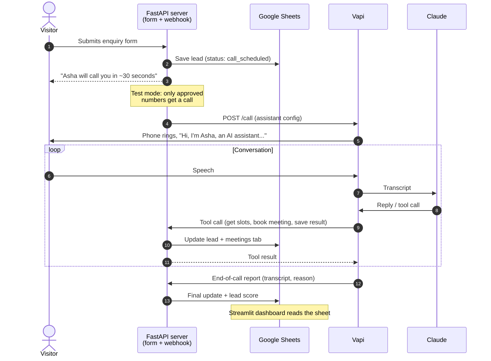

# CallBack AI: an AI voice agent that calls back new enquiries within a minute

Businesses lose leads by calling back enquiries late. Studies of web leads consistently find that leads contacted within minutes are far more likely to convert than leads called hours later.

**CallBack AI** calls every new website enquiry about 30 seconds after the form is submitted. It confirms what the person needs, asks qualifying questions (service, budget, timeline), answers FAQs, and books a strategy call. Everything is logged to Google Sheets with a **hot / warm / cold lead score** and the reason for it.

> 🎥 **Demo video:** _coming soon_ <!-- replace with a link / GIF -->

Demo business: **Brightpath Digital**, a fictional Bengaluru digital marketing agency.

## How it works



| Piece | What it does |
|---|---|
| **Enquiry form** (`GET /`) | Name, phone, company, service, message, language, consent. Saves the lead, then calls in the background. |
| **Voice agent** (Vapi + Claude Haiku) | States it's an AI in its first sentence, confirms the enquiry, qualifies, answers only from `faq.md`, books a slot or a callback, and handles "not interested", "call me later" and voicemail. English and Hindi. |
| **Tools** (`POST /vapi/webhook`) | `get_available_slots`, `book_meeting` (no double booking), `save_call_result` |
| **Lead scoring** | Rule-based points for intent, budget and timeline, giving hot, warm or cold with a written reason |
| **Storage** | Google Sheets (tabs `enquiries` and `meetings`) or local CSV files with the same columns |
| **Dashboard** (Streamlit) | Total enquiries, people reached, meetings, hot leads, median time to call, outcomes chart, lead-score chart, hot-lead list, upcoming meetings, follow-ups |

### Lead scoring (out of 8)

| | +3 | +2 | +1 | 0 |
|---|---|---|---|---|
| **Intent** | meeting booked | interested | maybe / call later | |
| **Budget** | above ₹1L a month | ₹50k–1L | ₹25k–50k or not sure | under ₹25k |
| **Timeline** | | within a month | 1–3 months | just exploring |

**Hot** is 6 or more, **warm** is 3–5, and **cold** is 0–2. "Not interested" is always cold. It's plain Python, not an AI judgement, so the same answers always give the same score and every score explains itself. For example: *"Meeting booked (+3), budget ₹50k–1L/month (+2), timeline within a month (+2) = 7/8."*

## Project structure

```
callback-ai/
├── callback_ai/
│   ├── config.py        # all settings, read from .env
│   ├── business.py      # business profile + FAQ loader, budget/timeline options
│   ├── leads.py         # enquiry columns, outcome rules
│   ├── scoring.py       # hot / warm / cold + reason
│   ├── scheduling.py    # meeting slots from office hours
│   ├── phone.py         # number cleanup, test-mode allow-list, masking
│   ├── prompts.py       # system prompt + spoken lines (English, Hindi)
│   ├── vapi.py          # assistant config (Claude, voice, 3 tools) + Vapi API
│   ├── dialer.py        # places the call after the form is submitted
│   ├── storage.py       # CSV or Google Sheets, upsert by ID
│   ├── analytics.py     # dashboard numbers
│   ├── server.py        # FastAPI: form + Vapi webhook
│   └── templates/enquiry_form.html
├── data/
│   ├── business.json    # Brightpath Digital: services, prices, office hours
│   └── faq.md           # 6 FAQs, editable without touching code
├── dashboard.py         # Streamlit
├── simulate_leads.py    # 20 fake leads to demo the dashboard
├── create_web_assistant.py  # free browser test call
├── tests/               # 36 tests: scoring, slots, form, full call lifecycle
├── render.yaml          # one-click deploy
└── .env.example         # every setting, documented
```

## Setup

### 0. Install

```bash
cd ~/Projects/callback-ai
python3 -m venv .venv
source .venv/bin/activate
pip install -r requirements.txt
cp .env.example .env
pytest -q
```

### 1. Try it with no accounts

```bash
python simulate_leads.py --clear
streamlit run dashboard.py
```

In a second terminal:

```bash
uvicorn callback_ai.server:app --reload --port 8000
```

Open http://localhost:8000. A number that isn't on the approved list is saved as a lead, but not called.

### 2. Accounts and keys

| Service | What to do | Goes in `.env` |
|---|---|---|
| **Vapi** | Sign up at dashboard.vapi.ai. Copy the *Private* key from Organization Settings → API Keys. | `VAPI_API_KEY` |
| **Claude** | Vapi includes Claude through its default integration, so you don't need a separate key. Optionally connect your own Anthropic key in Vapi → Integrations. | `CLAUDE_MODEL` |
| **Phone number** | To call Indian +91 mobiles, import a **Twilio** number into Vapi (Phone Numbers → Import) and enable India under Twilio → Voice → Geo permissions. Copy the number's **ID**. | `VAPI_PHONE_NUMBER_ID` |
| **Google Sheets** | In Google Cloud, create a project and enable the *Google Sheets API*. Create a **service account** and download its JSON key to `credentials/service-account.json`. Create a blank sheet and **share it with the service account's email** as Editor. The tabs are created automatically. | `STORAGE_BACKEND=sheets`, `GOOGLE_SHEET_ID` |
| **ngrok** | `brew install ngrok`, then sign up and run `ngrok config add-authtoken …` | `PUBLIC_BASE_URL` |

### 3. Run it for real

Start the server:

```bash
uvicorn callback_ai.server:app --reload --port 8000
```

In a second terminal, expose it:

```bash
ngrok http 8000
```

Put the ngrok URL in `PUBLIC_BASE_URL`, generate a `VAPI_WEBHOOK_SECRET`, and add your own number to `ALLOWED_NUMBERS`.

1. **Free browser test:** this creates a test enquiry and prints a link. Click "Talk to Assistant" there.
   ```bash
   python create_web_assistant.py
   ```
2. **Real call:** open your ngrok URL, submit the form with your own number, and your phone rings about 30 seconds later.
3. Watch the row fill in, in Google Sheets or the dashboard.

### 4. Deploy (Render, free)

Push to GitHub, then in Render choose **New → Blueprint** and pick the repo. Fill in the secrets it asks for, and paste the whole service-account JSON into `GOOGLE_CREDENTIALS_JSON`. The free tier sleeps when idle, so open `/health` before a demo to wake it up.

## Safety and ethics

- **AI disclosure is hard-coded** in the first sentence in every language, and a test checks it.
- **Consent:** the form needs an explicit tick to receive a call from an AI assistant.
- **Test mode is on by default.** Only `ALLOWED_NUMBERS` are called; other leads are saved but not called.
- **No double calls:** the same number submitting again within 10 minutes isn't called twice.
- **Prompt-injection guard:** the visitor's free-text message is fenced in tags, length-limited, and labelled as information, never instructions.
- The agent only quotes prices from `business.json` and `faq.md`, and never invents discounts or guarantees.
- Phone numbers are masked in logs and, by default, on the dashboard. The webhook rejects requests without the shared secret.

## Known limitations and next steps

- **Verifying the number belongs to the visitor:** in production, a public form could be used to make the agent call someone else's number. Add OTP verification or reCAPTCHA before going live without test mode.
- **Calendar:** slots come from office hours in `business.json`. The next step is Google Calendar: read real availability and send invites automatically. Today the team sends the Meet link by hand.
- **Automatic retries:** "call later" and "no answer" are flagged for a human, not redialled automatically.
- **Background calls:** they run in the web server process. At scale, a job queue (for example Celery, RQ or Cloud Tasks) would survive restarts.
- **CSV mode:** for local use only; Google Sheets is the shared store.

## Results

_Fill in after your test calls, for example: "N test calls in English and Hindi; median 34 s from form to ring; meeting booked in X of N; lead score matched my own judgement in Y of N."_
